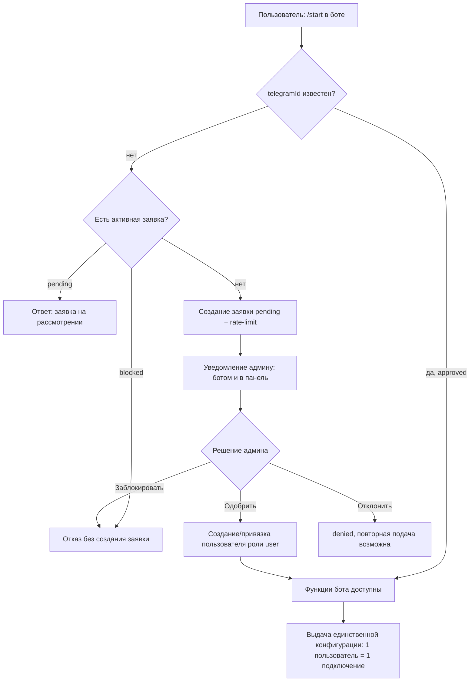
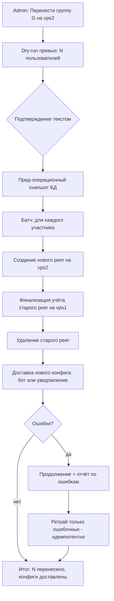

# Техническое задание
## Веб-панель управления VPN-инфраструктурой (аналог Amnezia Web Panel)

| | |
|---|---|
| **Версия документа** | 1.2 |
| **Дата** | 2026-11-10 |
| **Основание** | Анализ исходного кода проекта Amnezia-Web-Panel + ревью ТЗ v1.1 |
| **Стек-прототип** | Python 3.11–3.13, FastAPI, asyncio, Paramiko (SSH), Jinja2, Vanilla JS, SQLite-хранилище (`panel.db`), Docker |

---

## 0. Глоссарий

| Термин | Определение |
|---|---|
| **Сервер (нода)** | Удалённый VPS, управляемый панелью по SSH. |
| **Инстанс протокола** | Один развёрнутый контейнер протокола/сервиса на сервере (ключ вида `awg2`, `awg2__2`). |
| **Подключение (peer/клиент)** | Запись клиента внутри инстанса протокола; в документе термины «peer» и «клиент» синонимичны «подключению». |
| **Владелец** | Пользователь панели, которому привязано подключение (`user_connections`). |
| **Эпоха учёта** | Идентификация физического peer'а (container ID, интерфейс, inode) для детекции сброса/пересоздания счётчиков. |
| **Exit-узел** | Сервер-egress: точка выхода трафика, отличная от сервера-entry, к которому подключены клиенты. |
| **Self-service** | Самостоятельное создание подключений пользователем роли `user`. |
| **Audit trail** | Журнал значимых действий пользователей панели (файл + таблица критичных событий). |
| **Finalization** | Финализация учёта: чтение финального счётчика удалённого peer'а и коммит дельты перед архивацией. |

**Единое правило времени:** все метки времени в БД, журналах, API и «календарном» сбросе квот — **UTC**; таймзона применяется только в отображении UI.

---

## 1. Общее описание

### 1.1. Назначение системы

Система представляет собой веб-панель для централизованного управления VPN-инфраструктурой на удалённых серверах Ubuntu 20.04/22.04/24.04 (x86_64 / ARM64). Панель подключается к серверам по SSH (пароль или приватный ключ) и управляет установкой, настройкой и эксплуатацией VPN-протоколов и вспомогательных сервисов через Docker.

### 1.2. Ключевые цели

1. Единый дашборд для управления множеством серверов и несколькими VPN-протоколами на каждом из них.
2. Совместимость с официальными клиентами Amnezia (автоматическое обнаружение уже установленных протоколов и пользователей при добавлении существующего сервера).
3. Разграничение доступа по ролям: администратор, поддержка (support), обычный пользователь, самообслуживание (self-service).
4. Учёт трафика, квоты, лимиты скорости, срок действия аккаунтов.
5. Доставка конфигураций пользователям (Web, Telegram-бот, публичные ссылки, PWA).
6. Отказоустойчивость: бэкапы (локальные и в Telegram), восстановление из панели, failover exit-узлов, защита целостности данных учёта.

### 1.3. Поддерживаемые протоколы и сервисы

**VPN-протоколы:**
- **AmneziaWG (AWG)** — три сосуществующих варианта: AWG 3.1, AWG 2.0, AWG Legacy (обфускация S3/S4 против DPI);
- **Классический WireGuard** — с мониторингом трафика;
- **Xray (XTLS-Reality)** — VLESS-Reality, маскировка под HTTPS; чтение как «панельной» раскладки (`meta.json` + `clientsTable.json`), так и нативной раскладки Amnezia (`xray_*.key`);
- **Telemt (Telegram MTProxy)** — TLS-эмуляция, квоты, лимиты IP, отслеживание сессий;
- **Cloudflare WARP** — контур WARP-подключения (в т.ч. WARP внутри контейнера панели — образ `latest-warp`);
- **Exit-узлы (entry ≠ egress)** — выделенный сервис egress (`amnezia-exit`, порт `55520/udp`, приватная транзитная подсеть, опциональная обфускация hop-ов).

**Сервисы:**
- **AmneziaDNS** — внутренний DNS-резолвер (Unbound) в приватной docker-сети;
- **AdGuard Home** — DNS-блокировщик рекламы; режимы «заменить AmneziaDNS» и «параллельно»; опциональное открытие web UI / DoT / DoH на хосте;
- **SOCKS5-прокси** — 3proxy, односчётная модель, автогенерация 16-символьного пароля;
- **NGINX + Let's Encrypt** — обратный прокси и автоматизация HTTPS-сертификатов.

> Конкретные значения портов, подсетей и лимитов зафиксированы в **Приложении А** (design-решения) и не являются частью требований.

---

## 2. Роли и модель доступа

### 2.1. Перечень ролей

| Роль | Идентификатор | Вход в панель | Описание |
|---|---|---|---|
| Администратор | `admin` | Да | Полный доступ ко всем функциям |
| Поддержка | `support` | Да | Операционный доступ: просмотр и работа с серверами/подключениями, без изменений, влияющих на инвентарь и данные |
| Пользователь | `user` | Да | Доступ только к своим подключениям (`/my`) |
| Запись без входа | `none` | Нет | «Record-only» учётная запись: не может входить даже при установленном пароле; используется для владельцев подключений, которым не нужен доступ в панель |
| Публичный посетитель | — | Нет | Доступ только к странице share-ссылки `/share/{token}` |

### 2.2. Матрица полномочий

Матрица — **источник истины** по разграничению; формулировки FR не расширяют её.

| Возможность | admin | support | user | none |
|---|:-:|:-:|:-:|:-:|
| Вход в панель | ✔ | ✔ | ✔ | ✖ |
| Дашборд серверов | ✔ | ✔ | ✖ | ✖ |
| Добавление сервера (мастер подключения SSH) | ✔ | ✖ | ✖ | ✖ |
| Просмотр серверов, статусов протоколов, ping, статистики хоста | ✔ | ✔ | ✖ | ✖ |
| Редактирование/удаление/сортировка серверов | ✔ | ✖ (только просмотр) | ✖ | ✖ |
| Перезагрузка сервера, «очистка сервера» (wipe) | ✔ | ✖ | ✖ | ✖ |
| Установка/удаление протоколов и сервисов | ✔ | ✖ | ✖ | ✖ |
| Управление подключениями (создание/удаление/enable/disable, выгрузка конфигов) | ✔ | ✔ | свои | ✖ |
| Просмотр «ничьих»/не принадлежащих подключений | ✔ | ✔ | ✖ | ✖ |
| Настройка лимита скорости подключения | ✔ | ✖ | ✖ | ✖ |
| Управление пользователями панели (создание/роли/enable/disable) | ✔ | ✖ | ✖ | ✖ |
| Настройки панели (SSL, Telegram, self-service и т.д.) | ✔ | ✖ | ✖ | ✖ |
| Бэкап/восстановление БД, ZIP-архив состояния, скачивание бэкапа | ✔ (только admin) | ✖ | ✖ | ✖ |
| Восстановление из бэкапа через UI панели (см. 3.11) | ✔ | ✖ | ✖ | ✖ |
| Восстановление учёта (recovery, orphans, финализация) | ✔ | ✖ | ✖ | ✖ |
| Просмотр audit trail | ✔ | ✔ (только чтение) | ✖ | ✖ |
| API Bearer-токены | ✔ (токен наследует роль создателя: admin или support) | ✔ | ✖ | ✖ |
| Страница «Мои подключения» `/my`, self-service создание подключений | ✔ | ✔ | ✔ | ✖ |
| Удаление self-service-подключения | ✔ | ✔ | свои self-service | ✖ |
| Публичная share-страница (по токену + опциональный пароль) | — | — | — | ✔ (по токену) |

### 2.3. Правила авторизации

- **Аутентификация**: логин/пароль, пароли хранятся в виде хэша (argon2id или bcrypt). Первоначальные учётные данные: `admin`/`admin` (обязательная смена после первого входа).
- **Brute-force защита входа**: прогрессивная задержка после N неудачных попыток на пару логин+IP (например, 5 неудач → задержка 30 с, далее экспоненциально), блокировка IP по лимиту; CAPTCHA — дополнительный слой, не замена.
- **Сессии**: подписанные cookie-сессии (ключ `SECRET_KEY`); абсолютный срок жизни сессии (по умолчанию 7 дней) и idle-таймаут (по умолчанию 24 ч), оба настраиваются; инвалидация сессий при отключении (`enabled=false`) или понижении роли пользователя, а также при `role=none`.
- **CAPTCHA** на форме входа (процессно-локальное хранилище challenge, атомарное «потребление» ответа).
- **2FA (опционально, admin)**: TOTP для роли `admin`, включается в настройках; при включении обязателен для всех admin-аккаунтов.
- **Bearer-токены API**: токены вида `awp_...` для внешних интеграций; в БД хранится только SHA-256 хэш; полное значение показывается однократно при создании; токен наследует роль создателя (admin/support) и автоматически перестаёт действовать при отключении/понижении владельца; каждый endpoint, принимающий сессию, принимает и токен. **Токены имеют опциональный TTL и дату истечения; поддерживаются ротация (создание нового + отзыв старого) и отзыв в один клик.**
- **Same-origin / CSRF**: изменения через браузер требуют same-origin метаданных; критичные операции (бэкап-архив, скачивание, восстановление) — дополнительно CSRF-nonce.
- **Rate-limit API**: глобальный rate-limit на `/api/*` (скользящее окно, настраиваемый, дефолт — разумный для UI); отдельные повышенные лимиты на auth-эндпоинты.
- **Запрет навигации**: при 403 на `/api/*` без валидной сессии — перенаправление на логин (кроме `/api/auth/*`, `/api/share/*`, Bearer-запросов).

---

## 3. Функциональные требования

> Приоритизация: каждый FR имеет метку **[MVP]** / **[Этап 2]** / **[Этап 3]** (см. раздел 9). MoSCoW-соответствие: MVP = Must, Этап 2 = Should, Этап 3 = Could.

### 3.1. Управление серверами

- **FR-3.1.1 [MVP]** Добавление сервера: адрес, SSH-порт, логин, пароль или приватный ключ. Мастер добавления — только для администратора.
- **FR-3.1.2 [MVP]** Автоматическая верификация добавленного сервера: обнаружение установленных протоколов, существующих пользователей, текущих конфигураций.
- **FR-3.1.3 [MVP]** Редактирование, удаление и перетаскиванием (drag-and-drop) сортировка серверов; при сортировке обновляются ссылки `server_id` в сохранённых подключениях.
- **FR-3.1.4 [MVP]** Стабильный идентификатор `uid` для каждого сервера, назначаемый при добавлении и используемый для межсерверных ссылок (переживает сортировку и удаление).
- **FR-3.1.5 [MVP]** Индикатор «живого» ping для каждого сервера — неблокирующий TCP-проб до SSH-порта, параллельно для всех серверов.
- **FR-3.1.6 [MVP]** Перезагрузка сервера из интерфейса.
- **FR-3.1.7 [Этап 2]** «Очистка сервера»: однократный sudo-скрипт, удаляющий все контейнеры/образы `amnezia-*` и каталог `/opt/amnezia`; обязательное подтверждение текстом + audit-событие.
- **FR-3.1.8 [MVP]** Параллельный опрос статусов всех установленных протоколов/сервисов.
- **FR-3.1.9 [MVP]** Статистика хоста (CPU, память, диск, нагрузка) через единый bash-проб с частичным результатом при сбое; батчевая доставка в UI.
- **FR-3.1.10 [Этап 2]** Публичный адрес на уровне экземпляра протокола: если инстанс доступен по другому адресу (второй IP, порт-форвард, домен), задать его; все конфиги, `vless://` и `tg://`-ссылки будут указывать на него. Настройка переживает переустановку протокола.
- **FR-3.1.11 [MVP]** SSH-онбординг: проверка отпечатков хоста (SSH trust-on-first-use с закреплением known-hosts, отдельный файл доверия панели), circuit breaker для SSH, пул соединений.
- **FR-3.1.12 [Этап 2]** SSH jump-host: возможность подключаться к целевым серверам через промежуточный.
- **FR-3.1.13 [MVP]** **Шифрование секретов серверов at rest**: SSH-пароли и приватные ключи шифруются симметрично (AES-256-GCM) мастер-ключом; мастер-ключ задаётся переменной окружения `PANEL_MASTER_KEY` (обязателен при первом старте, опционально — файл ключа в volume); ключ **не** совпадает с `SECRET_KEY`; расшифровка только в памяти, never-echo секретов в API-ответах, статусах и логах.

### 3.2. Управление протоколами и сервисами

- **FR-3.2.1 [MVP]** Установка/удаление протоколов AWG/WG на сервере из «маркетплейса» шаблонов (presets). Остальные протоколы/сервисы — [Этап 2]+.
- **FR-3.2.2 [MVP]** Мультипротокольность: несколько экземпляров протоколов на одном сервере (например, `awg2` и `awg2__2`); мульти-инстансы — для поддерживающих протоколов.
- **FR-3.2.3 [MVP]** AmneziaWG: установка ядра/пользовательского бэкенда, обновление kernel-модуля и userspace, совместимость версий (AWG 3.x/2.0/legacy), выбор порта, junk-параметров (S1/S2/I1–I5), включение BBR.
- **FR-3.2.4 [Этап 3]** Dual-stack IPv6: три-state политика (`auto`/`off`/`on`); автоматическое включение только при сквозной работоспособности IPv6 (глобальный адрес на хосте и IPv6-маршрут внутри контейнера протокола); управление Docker IPv6 с гейтами установки и диагностикой ошибок.
- **FR-3.2.5 [Этап 2]** Xray: пин версии ядра, чтение «панельной» и «нативной» раскладок клиентов, выдача `vless://`-ссылок.
- **FR-3.2.6 [Этап 2]** Telemt: установка с автонастройкой docker apt/yum-репозитория; квоты, лимиты IP; собственные `tg://`-ссылки, запись публичного адреса в `config.toml` без перезапуска.
- **FR-3.2.7 [Этап 3]** WARP: добавление WARP-контура к AWG-инстансам; проверка архитектуры; управление состоянием через асинхронные операции (202 Accepted + статус).
- **FR-3.2.8 [Этап 2]** Редактирование «сырых» конфигураций протоколов в контейнерах из UI (с audit-событием и snapshot-ом предыдущей версии конфига).
- **FR-3.2.9 [Этап 3]** Бэкап/миграция протоколов (Alpha): перенос конфигураций протоколов между нодами для обслуживания/восстановления/миграции.
- **FR-3.2.10 [Этап 3]** Тонкая настройка хоста (host tuning): sysctl, лимиты и т.п.

### 3.3. Exit-узлы (entry ≠ egress) — [Этап 3]

- **FR-3.3.1** Установка сервиса «Exit Node» (`amnezia-exit`): AmneziaWG-слушатель на выделенном UDP-порту (см. Приложение А), приватная транзитная подсеть, опциональная обфускация hop-ов.
- **FR-3.3.2** Связывание (link) AWG-инстанса на сервере-entry с exit-узлом: клиенты и их конфиги остаются на entry; entry делает SNAT в транзитный адрес и маршрутизирует через второй интерфейс (`exit0`) внутри контейнера.
- **FR-3.3.3** Kill-switch: устанавливается до поднятия клиентского туннеля — при недоступности exit трафик блокируется, а не утекает с IP entry.
- **FR-3.3.4** Живучесть связей: линки переживают перезапуск контейнеров, пересортировку серверов и переустановку любой из сторон; на странице Peers exit-узла — handshake и трафик по каждому entry.
- **FR-3.3.5** Default exit node в настройках: каждый устанавливаемый впредь AWG-инстанс автоматически линкуется к нему.
- **FR-3.3.6** DNS через exit: переключатель маршрутизации клиентского DNS через exit (требует AmneziaDNS на exit-узле), чтобы резолвер не видел страну entry.
- **FR-3.3.7** Автоматический failover (по умолчанию выключен): упорядоченный список резервных exit-ов; периодическая проверка активного линка (возраст handshake + опциональный HTTP-проб через `exit0`); после N подряд неудач — переключение на следующий здоровый backup без изменения клиентских peer-ов; configurable failback после заданного периода здоровья; при неудачном переключении — откат к предыдущему `exit0.conf`; состояние и журнал событий хранятся на инстансе; **событие failover/failback/отката отправляется алертом администратору (см. FR-3.10.13)**.
- **FR-3.3.8** MTU-цепочка (design-значения — в Приложении А); требование: сквозная цепочка клиент→exit должна помещаться в MTU 1500 для IPv4-эндпоинта.
- **FR-3.3.9** Пока активен линк — IPv6 клиенту запрещается (защита от утечки).

### 3.4. Подключения (VPN-клиенты)

- **FR-3.4.1 [MVP]** CRUD подключений per-protocol: создание peer'а/клиента, переименование, включение/отключение, удаление.
- **FR-3.4.2 [MVP]** Выдача конфигураций: `.conf`-файл (WG/AWG), QR-код, `vpn://`-ключ Amnezia, `vless://`/`tg://` ссылки (Xray/Telemt — по мере поддержки протоколов).
- **FR-3.4.3 [MVP]** Привязка подключения к пользователю панели (`user_connections`): владелец, сервер, протокол, client_id.
- **FR-3.4.4 [MVP]** Жизненный цикл создания peer'а: асинхронная очередь, журнал операций (`operation_id`, идемпотентный ретрай), финализация, lifecycle-lock (взаимная блокировка между созданием, восстановлением, raw-config и ownership-операциями).
- **FR-3.4.5 [Этап 2]** Лимит скорости на подключение (admin-only; протоколы с поддержкой).
- **FR-3.4.6 [Этап 2]** Split tunnel (серверная сторона) для AWG-инстансов: список маршрутов, направляемых в туннель/мимо него, на уровне конфигурации сервера.
- **FR-3.4.7 [Этап 3]** Smart Route: клиентская маршрутизация на уровне AWG-инстансов (наборы доменных/гео-правил, доставляемые в конфиг клиента) — отличается от FR-3.4.6 тем, что применяется на клиенте, а не на сервере.
- **FR-3.4.8 [MVP]** Переименование подключения без гонок; атомарная запись таблиц клиентов; блокировки на чтение/запись.

### 3.5. Учёт трафика и квоты

- **FR-3.5.1 [MVP]** Живой учёт трафика WG/AWG по `wg/awg show <iface> transfer` (точные целочисленные RX/TX); приватные ключи счётчиками не запрашиваются.
- **FR-3.5.2 [MVP]** Полный обход всех установленных инстансов протоколов; алиасы одного физического контейнера опрашиваются один раз; семплы сохраняют connection ID, полный ключ протокола, client ID и идентификатор сервера; дубликаты владельцев одного физического peer'а логируются и пропускаются.
- **FR-3.5.3 [MVP]** Эпохи: хэш эпохи из container ID/времени старта/PID, host boot ID, ifindex интерфейса, inode/ctime UAPI-сокета; метаданные проверяются до и после запроса счётчиков; смена эпохи/сброс счётчика фиксируется диагностикой `traffic_accounting_gap` (`counters_verified_final=false`).
- **FR-3.5.4 [MVP]** Базлайны и итоги переживают перезапуск панели; календарный сброс (UTC, см. раздел 0) сохраняет сырые базлайны peer'ов и lifetime-итоги; недоступность SSH в неизменной эпохе — догоняет при следующем успешном чтении.
- **FR-3.5.5 [MVP]** **Интервал опроса счётчиков**: по умолчанию 60 с (настраивается в диапазоне 30–300 с). Требование: квота применяется не позднее, чем через 2 полных цикла опроса после исчерпания. Квоты пользователей: `traffic_used` / `traffic_total` / `traffic_limit`; автоматическое отключение при исчерпании (`disable_reasons`, причина `quota`); срок действия аккаунтов (expiration, UTC); ручные причины блокировки; примирение доступа (access reconciliation) при изменении статусов.
- **FR-3.5.6 [Этап 2]** Общий (shared) учёт трафика для share-страниц; учёт при удалении серверов (архив accounting-данных, «destructive guards»).

### 3.6. Пользователи панели

- **FR-3.6.1 [MVP]** CRUD пользователей: имя, роль (`admin`/`support`/`user`/`none`), пароль (обязателен для любой роли, кроме `none`), Telegram ID, включение/отключение одной кнопкой.
- **FR-3.6.2 [MVP]** Управление подключениями пользователя: привязка/отвязка (unlink) существующих подключений к пользователю.
- **FR-3.6.3 [MVP]** Отвязка владельца: отключённые/отсутствующие peer'ы отвязываются напрямую; активные — с `stop: true` (остановка peer'а на ноде перед отвязкой); при нечитаемом финальном счётчике — `allow_unverified: true`.
- **FR-3.6.4 [MVP]** Автоматическая инвалидация: отключение пользователя завершает его сессии и Bearer-токены; понижение до `none`/`user` отзывает права токенов.
- **FR-3.6.5 [MVP]** Экспорт списка подключений любого пользователя и выгрузка конфигов — admin/support.
- **FR-3.6.6 [Этап 3]** Внешняя синхронизация пользователей: generic-слой импорта пользователей из внешних источников (import connector API); конкретные коннекторы — вне скоупа текущей версии.

### 3.7. Самообслуживание (self-service) и «Мои подключения» — [Этап 2]

- **FR-3.7.1** Страница `/my` для ролей user и выше: список своих подключений, выгрузка конфигов/QR/ссылок. *[MVP — просмотр и выгрузка; self-service создание — Этап 2]*
- **FR-3.7.2** Self-service создание подключений пользователем: глобальный включатель в настройках; отдельные каналы `web_enabled` и `telegram_enabled`; выбор разрешённых протоколов (AWG-семейство, WG, Xray, Telemt); включение self-service на уровне конкретного сервера; лимит подключений на пользователя (`max_connections_per_user`); rate-limit создания; уникальность имени.
- **FR-3.7.3** Пользователь может удалять **только** self-service-подключения (`created_by='self_service'`); удалить подключение с незавершённой финализацией учёта нельзя (409 `traffic_finalization_required`).
- **FR-3.7.4** API: `GET /api/my/connections`, `GET /api/my/connections/options`, `POST /api/my/connections/add`, `POST /api/my/connections/{id}/delete`, `POST /api/my/connections/{id}/config`.

### 3.8. Публичный шеринг конфигураций — [MVP]

- **FR-3.8.1** Для каждого пользователя — share-токен (`share_token`), включатель (`share_enabled`) и опциональный пароль (хэш).
- **FR-3.8.2** Публичная страница `/share/{token}`: без входа в панель; авторизация по паролю (если установлен) через сессионный revision-флаг; просмотр списка подключений и выгрузка конфигураций.
- **FR-3.8.3** Настройка шеринга — endpoint `POST /api/users/{id}/share/setup` (admin); токен стабилен, пароль — хэшем.
- **FR-3.8.4** **Перегенерация и ревокация**: admin может перегенерировать share-токен (старый мгновенно недействителен) и полностью отозвать доступ; ревокация/перегенерация — audit-событие.

### 3.9. Telegram-бот — [Этап 2]

- **FR-3.9.1** Интеграция через настройки (токен бота); запуск/остановка из UI. Механизм — long polling (дефолт, работает без публичного HTTPS) или webhook (secret_token, настраиваемый URL) — выбирается в настройках.
- **FR-3.9.2** Привязка аккаунтов панели по Telegram ID/username.
- **FR-3.9.3** Пользовательские функции: список «Мои подключения», выгрузка конфигов и ссылок, self-service создание/удаление подключений, смена языка интерфейса.
- **FR-3.9.4** Администраторские функции: управление серверами (`/servers`), протоколами, пользователями, подключениями; просмотр карточки пользователя (роль, статус).
- **FR-3.9.5** Локализация интерфейса бота на все языки панели.
- **FR-3.9.6** Приём ежедневного автобэкапа и алертов администратором (см. FR-3.10.10, FR-3.10.13): работает и при long polling, и при webhook.

#### 3.9.1. Регистрация пользователя через бота с подтверждением администратора — [Этап 2]

Механизм gated-доступа: незнакомый боту пользователь не получает никаких функций до явного одобрения администратором; после одобрения — доступ к выдаче **ровно одной** конфигурации.

- **FR-3.9.7** Включатель механизма в настройках (`bot_registration.enabled`); при выключенном действует прежняя модель (привязка Telegram ID администратором через панель, FR-3.9.2).
- **FR-3.9.8** **Подача заявки**: `/start` от неизвестного Telegram ID открывает диалог регистрации (опционально: запрос имени/комментария); создаётся заявка `pending` (telegram_id, username, display name, время UTC, источник). Анти-абьюз: rate-limit заявок с одного Telegram ID и глобальный лимит `pending`-заявок (настраивается, Приложение А); превышение — вежливый отказ без создания заявки.
- **FR-3.9.9** **Жизненный цикл заявки**: `pending → approved | denied | blocked`; после `denied` повторная подача разрешена (в пределах rate-limit); после `blocked` заявки от этого Telegram ID не принимаются вовсе. Заявки старше срока жизни (Приложение А) — авто-архивация в статус `expired` (повторная подача разрешена).
- **FR-3.9.10** **Рассмотрение админом — из двух мест, идемпотентно**: (а) inline-кнопки в сообщении бота «Одобрить / Отклонить / Заблокировать»; (б) раздел «Заявки бота» в панели (Users → Bot requests). Решение фиксируется единожды (гонка: кто первый; второй получает «уже обработано»); опциональный комментарий-причина; все решения — audit-события; уведомление заявителю о результате.
- **FR-3.9.11** **Одобрение**: создание пользователя панели (роль `user`, пароль не обязателен — вход только через бота) **или** привязка к существующей записи (`none`/record-only) по имени, указанному заявителем/админом; запись telegramId, статус `approved`; заявителю — приветствие и статус его единственной конфигурации. Дедупликация: если telegram_id уже привязан — привязка не дублируется.
- **FR-3.9.12** **Gate функций**: до `approved` бот отвечает только статусом заявки; команды выдачи конфигураций, self-service и любые данные — недоступны; после блокировки/отключения пользователя в панели (FR-3.6.4) — мгновенная потеря доступа к функциям бота.
- **FR-3.9.13** **Правило «один пользователь — одна конфигурация»**: approved-пользователь имеет **не более одной активной конфигурации** (принципиальный лимит `max_connections_per_user = 1` для ботового контура, Приложение А): (а) `/myconfig` отдаёт существующую конфигурацию (файл/QR/ссылка) без возможности создать вторую; (б) замена сервера/протокола = «перевыпуск»: удаление старого peer'а **с финализацией учёта** (FR-3.11.4) до создания нового; (в) сервер и протокол единственной конфигурации задаются админом в настройках бота (пул разрешённых серверов/протоколов) либо выбором из разрешённого списка при первом выпуске; (г) enforcement — серверная логика (409/отказ в боте), не только UI.
- **FR-3.9.14** **Эскалация и ревокация**: опциональное напоминание админу о `pending`-заявках старше N часов; авто-denial по таймауту (выкл. по умолчанию); отзыв доступа: «Заблокировать» в боте, отключение/удаление пользователя в панели, перегенерация привязки (unlink telegram_id) — мгновенно закрывают доступ, включая активные сессии бота.

#### 3.9.2. Приглашения пользователей (invite links) — [Этап 2]

Администратор распространяет одноразовые (или ограниченные по числу активаций) пригласительные deep-links бота; каждый новый пользователь регистрируется по приглашению, и админ видит всю цепочку «кто кого пригласил».

- **FR-3.9.15** **Создание приглашения**: admin (панель или бот) генерирует deep-link вида `https://t.me/<bot>?start=inv_<token>`; параметры: владелец-пригласитель (creator), целевая группа пользователей (см. 3.17, опционально), лимит активаций (по умолчанию 1), срок действия (nullable = бессрочно), комментарий. Полный токен отображается однократно, в БД — только хэш (аналогия Bearer-токенов).
- **FR-3.9.16** **Активация**: переход по deep-link = `/start inv_<token>`; валидный токен (не истёк, лимит не исчерпан, не отозван) открывает ускоренную регистрацию: заявка создаётся с признаком `invited_by` (создатель приглашения) и, если задано, с автопривязкой к целевой группе. По исчерпанию лимита/истечении токен автоматически недействителен (ответ «приглашение больше не активно»).
- **FR-3.9.17** **Подтверждение**: активация по приглашению **не отменяет** подтверждение админом (FR-3.9.10) — заявка с признаком `invited` помечается в списке заявок (бейдж «по приглашению от X»), но по-прежнему требует одобрения; опция `bot_registration.auto_approve_invited` (по умолчанию выкл.) разрешает авто-одобрение заявок по валидному приглашению.
- **FR-3.9.18** **Видимость связи «кто кого пригласил»**: (а) карточка пользователя — поле «Приглашён: X (дата, ссылка)»; (б) карточка/список приглашений — число активаций и список активировавших; (в) рекурсивная цепочка в карточке пользователя (A пригласил B, B пригласил C); (г) фильтр списка пользователей по пригласителю; (д) выгрузка списка «пригласитель → пользователи» (admin/support). Данные сохраняются и после отзыва приглашения.
- **FR-3.9.19** **Управление приглашениями**: список всех приглашений (активные/истёкшие/исчерпанные/отозванные), отзыв в один клик (мгновенно инвалидирует, активировавшие пользователи не затрагиваются), перегенерация; все действия — audit-события.
- **FR-3.9.20** **Счётчики и лимиты**: на приглашение — лимит активаций и rate-limit активаций с одного Telegram ID; анти-брутфорс: N невалидных `inv_` токенов подряд — временная блокировка registration-endpoint для этого Telegram ID.

### 3.10. Настройки панели

- **FR-3.10.1 [MVP]** Внешний вид: заголовок/подзаголовок сайта, логотип; тёмная/светлая тема.
- **FR-3.10.2 [Этап 2]** SSL-терминация самой панелью: сертификат и ключ (файлы или PEM-текст), порт; DuckDNS + автоматический сертификат (acme.sh, Linux-хосты).
- **FR-3.10.3 [MVP]** CAPTCHA: включение/настройка для страницы входа.
- **FR-3.10.4 [Этап 3]** Публичные туннели одной кнопкой: Cloudflare Quick Tunnel и ngrok; статус, PID, выданный HTTPS URL; установка/запуск/остановка/удаление управляемых бинарей; персистентное состояние (`tunnels_state.json`); совместимость с Windows/Linux/Docker.
- **FR-3.10.5 [Этап 2]** Self-service настройки (см. 3.7).
- **FR-3.10.6 [Этап 3]** Exit-узлы: default exit node (см. 3.3).
- **FR-3.10.7 [Этап 2]** SSH jump-host настройки.
- **FR-3.10.8 [Этап 2]** Split tunnel (серверная сторона, см. FR-3.4.6).
- **FR-3.10.9 [Этап 2]** Panel access: ограничение доступа к панели (IP allowlist).
- **FR-3.10.15 [Этап 2]** Настройки бота: пул серверов/протоколов для единственной конфигурации (FR-3.9.13), настройки регистрации и приглашений (FR-3.9.7, FR-3.9.15).
- **FR-3.10.10 [MVP]** **Автобэкап в Telegram**: ежедневный снимок `panel.db` (SQLite-снапшот в безопасный момент записи, WAL-checkpoint) сжимается (gzip) и отправляется ботом в чат/личку администратору; настройка: включатель, время отправки (UTC), ретеншн-подсказка; лимит файла Telegram учитывается автоматически (при превышении — отправка без вложения с инструкцией). Требуется настроенный Telegram-бот (FR-3.9.1); до настройки бота автобэкап деградирует в локальную ротацию копий (последние 7 файлов в каталоге `backups/`).
- **FR-3.10.11 [Этап 2]** Проверка обновлений панели: текущая версия в настройках, проверка свежих GitHub-релизов одной кнопкой; вывод changelog и совместимости версии схемы БД.
- **FR-3.10.12 [Этап 3]** Host tuning и RKN-блокировки (восстановление после блокировок при загрузке, сканирование, тумблеры, верификация блокировок).
- **FR-3.10.13 [MVP]** **Уведомления/алерты**: настройка получателя (Telegram-чат админа); события алертинга (каждое — с тумблером): сервер недоступен N минут, квота пользователя исчерпана, failover exit-линка сработал/откатился, истечение SSL-сертификата панели ≤ 14 дней, автобэкап не удался, обнаружены `traffic_accounting_gap` (сводно, не чаще раза в час).
- **FR-3.10.14 [MVP]** **Журналы (логи) в текстовом файле**: приложение-лог (`panel.log` + ротация по дням) — **текстовый файл** с ретеншеном **7 дней** (ротация: файл за день; старше 7 дней — перезапись/удаление новыми событиями); уровни DEBUG/INFO/WARNING/ERROR (уровень настраивается); в логи запрещено попадание секретов (SSH-пароли/ключи, Bearer-токены, share-пароли) — санитайзер на уровне логгера. Журнал аудита см. FR-3.16.2 (раздел 3.16).

### 3.11. Резервное копирование и восстановление

- **FR-3.11.1 [MVP]** **Простой бэкап/восстановление прямо в панели**: страница настроек «Бэкапы»: (а) скачать снимок БД; (б) **загрузить файл бэкапа (`.db` или `.db.gz`, в т.ч. файл из Telegram-автобэкапа) и восстановиться через UI** — без доступа к файловой системе хоста. Процедура in-panel restore: валидация файла (SQLite integrity check + проверка версии схемы), обязательный пред-restore снапшот текущей БД (локально, с возможностью скачать), применение через атомарную замену с перезаписью политики protected-записей (см. FR-3.11.3), перезапуск внутренних кэшей/соединений без остановки процесса.
- **FR-3.11.2 [Этап 3]** Полный ZIP-архив состояния (admin-only, same-origin + CSRF): `state/panel.db`, `trust/ssh_known_hosts` (панель) и системные пины, `manifest.json` — формат, версия панели, время UTC, размер и SHA256 каждого члена. Границы: 32 MiB/файл, 128 MiB всего, 2048 файлов; симлинки/спецфайлы — отказ; никакого SSH во время снимка.
- **FR-3.11.3 [MVP]** Политика protected-записей при восстановлении: по умолчанию сохраняются текущие счётчики/базлайны/ownership (профиль «merge-безопасный»); опция «полное восстановление» доступна только с подтверждением текстом; отказ (409) при попытке отмотать защищённые записи без явного подтверждения.
- **FR-3.11.4 [MVP]** Финализация linked-peer'ов администратором: чтение финального счётчика с удалённого peer'а, коммит дельты, запись tombstone в `accounting_recoveries`; при нечитаемом счётчике — fail-closed 409 с `can_force` и ретраем `allow_unverified`.
- **FR-3.11.5 [Этап 2]** Recovery «осиротевших» владельцев (edge cases): просмотр идентичности (без выдачи приватных ключей), режимы `repair` (смена владельца с сохранением квот/счётчиков, подтверждение текстом) и `archive_absent` (архивация верифицированно отсутствующего peer'а, подтверждение текстом); обязательный пред-restore снапшот БД и audit-событие перед мутацией.
- **FR-3.11.6 [Этап 3]** Полное аварийное восстановление (офлайн): скрипт (`panel_recovery.py`) с operation_id, SHA256-предусловием, эксклюзивным runtime-lease, атомарной заменой файла БД — для случая, когда панель не запускается.
- **FR-3.11.7 [MVP]** **Восстановление из Telegram-бэкапа**: сохранённый файл из FR-3.10.10 подаётся на тот же in-panel restore (FR-3.11.1); требование: формат Telegram-бэкапа идентичен формату скачиваемого снимка (один валидатор).

### 3.12. API и интеграции

- **FR-3.12.1 [MVP]** **Версионирование API**: все машинные эндпоинты под префиксом `/api/v1/`; `/api` — алиас на текущую версию на время v1; ломающие изменения — только в новой версии.
- **FR-3.12.2 [MVP]** Автодокументируемый API: Swagger UI (`/docs`) и ReDoc (`/redoc`).
- **FR-3.12.3 [MVP]** Группы маршрутов: Authentication, Servers, Protocols, Connections, Users, Self-service, Sharing, Settings, API Tokens, System Templates (HTML).
- **FR-3.12.4 [MVP]** Bearer-токены на всех admin-эндпоинтах (см. 2.3); примеры: список пользователей, добавление сервера, ping-проб, установка публичного эндпоинта инстанса.
- **FR-3.12.5 [MVP]** Единообразные JSON-ошибки с `error_code`; общая схема: `{"error_code": "...", "message": "...", "details": {...}}`.

### 3.13. Интерфейс (UI/UX)

- **FR-3.13.1 [MVP]** Дашборд серверов с карточками, ping-индикаторами, статусами протоколов.
- **FR-3.13.2 [MVP]** Страница сервера: карточки инстансов протоколов/сервисов, peers, статистика хоста, управление выходными узлами (при установленном скоупе).
- **FR-3.13.3 [MVP]** Мастер добавления сервера (`/servers/new`) — только admin.
- **FR-3.13.4 [MVP]** Раздел «Пользователи» с карточками, ролями, квотами, статусами.
- **FR-3.13.5 [MVP]** «Мои подключения» — карточки подключений, QR, скачивание.
- **FR-3.13.6 [MVP]** Настройки — вкладки по разделам (3.10), включая вкладку «Бэкапы» (FR-3.11.1).
- **FR-3.13.7 [MVP]** Дизайн-система: тёмная/светлая тема, SVG-иконки, адаптивность (мобильная раскладка, нижняя tab-панель по роли, компактный заголовок, touch-friendly элементы).
- **FR-3.13.8 [MVP]** Модальные окна управления сервером, SSH-онбординг, share-страница, страница входа.
- **FR-3.13.9 [Этап 3]** PWA: manifest, service worker (кэширование **только** `/static/*`; HTML и `/api/*` — всегда сеть), установка на телефон/десктоп, иконки, safe-area для standalone-режима.
- **FR-3.13.10 [MVP]** `noindex`/robots для приватных страниц; кэш-политика статики; запрет кэширования ответов бэкапов.
- **FR-3.13.11 [MVP]** **Real-time обновления UI: SSE (Server-Sent Events)** как транспорт живых данных (статусы серверов, прогресс операций, счётчики) с автопереподключением; polling — fallback для несовместимых клиентов.

### 3.14. Локализация и i18n

- **FR-3.14.1 [MVP]** Языки: английский (fallback-язык по умолчанию), русский. Дополнительные — [Этап 2]: французский, китайский, персидский.
- **FR-3.14.2 [Этап 2]** Полная поддержка RTL для персидского.
- **FR-3.14.3 [MVP]** Переключение языка пользователем (cookie), локализация Web и Telegram-бота.
- **FR-3.14.4 [MVP]** Правила i18n: fallback на английский при отсутствии ключа; корректная плурализация (CLDR-формы — критично для ru); даты/числа — с учётом локали, время — UTC (раздел 0).

### 3.15. Хранение данных, схема и миграции

- **FR-3.15.1 [MVP]** Локальное SQLite-хранилище (`panel.db`, путь — переменная `DB_FILE`) с асинхронными блокировками (`asyncio.Lock`) на запись; режим WAL, транзакционная целостность, атомарные коммиты с fsync; один процесс панели обязателен (in-process locks).
- **FR-3.15.2 [MVP]** Асинхронная архитектура: неблокирующие фоновые операции, UI не зависает при недоступных удалённых серверах.
- **FR-3.15.3 [MVP]** Персистентность состояния через Docker volume (`amnezia_data`), настройка через `docker-compose.yml` / переменные окружения (`SECRET_KEY`, `PANEL_MASTER_KEY`, `DB_FILE`, `APP_PORT`).
- **FR-3.15.4 [MVP]** Идемпотентные операции с `operation_id` (создание peer'а, восстановление) — ретрай того же ID после неопределённого ответа.
- **FR-3.15.5 [MVP]** **Миграции схемы**: встроенный мигратор (таблица `schema_version` + упорядоченные миграции); автоматическое применение при старте панели с предварительным снапшотом БД (в `backups/pre-migrate/`); миграции — только forward; даунгрейд не поддерживается (в релизе указывается минимальная версия схемы).
- **FR-3.15.6 [MVP]** **Журналы — вне БД**: операционные логи — текстовые файлы (FR-3.10.14); журналы создания peer'ов (`operation_id`) и неопределённых SSH-исходов — таблицы БД (это данные операций, а не логи); audit-события — гибрид (см. 3.16).
- **FR-3.15.7 [MVP]** Graceful degradation при переполнении диска: детект свободного места (< критического порога — алерт, < аварийного — панель переходит в read-only для мутирующих операций, кроме релиза блокировок и алертинга).

### 3.16. Аудит и наблюдаемость (observability)

- **FR-3.16.1 [MVP]** **Health-check**: `GET /health` (живость процесса, состояние БД) без аутентификации, только локально/по allowlist; `GET /api/v1/system/status` — расширенный статус (время работы, версия схемы, размер БД, статистика фоновых задач).
- **FR-3.16.2 [MVP]** **Audit trail**: журнал значимых мутаций: вход/выход, неудачные входы, CRUD серверов/протоколов/подключений/пользователей/токенов, смена настроек, бэкапы/восстановления, ревокации share-токенов, raw-config правки. Реализация — **гибрид**: таблица `audit_log` в БД (структурированные события, ретеншн 90 дней) + зеркало в ежедневный текстовый файл `audit-YYYY-MM-DD.log` (7 дней, FR-3.10.14). Событие: время UTC, actor (пользователь/токен), действие, объект, IP, результат. Просмотр — фильтруемая таблица в UI (admin; support — read-only).
- **FR-3.16.3 [Этап 2]** **Экспорт метрик**: опциональный endpoint `/metrics` (Prometheus-текстовый формат; вкл/выкл + allowlist в настройках): число серверов по статусам, длительность SSH-проб, размер очереди операций, ошибки учётного цикла, HTTP-латентности.

### 3.17. Группы пользователей и массовый перенос — [Этап 2]

Группы — операционная сущность для массового управления: привязка пользователей к группе и **перенос всех подключений группы** на другой сервер с перевыпуском и доставкой новых конфигураций.

#### 3.17.1. Группы

- **FR-3.17.1 [Этап 2]** **CRUD групп**: имя (уникальное), описание, цвет/метка; группа опционально задаёт: пул разрешённых серверов/протоколов (для выпуска конфигураций по FR-3.9.13), лимит подключений на пользователя (перекрывает глобальный), дефолтную квоту трафика и срок действия для новых участников.
- **FR-3.17.2 [Этап 2]** **Членство**: пользователь состоит максимум в одной группе; назначение/смена/снятие группы — по одному или массово (выбор чекбоксами в списке пользователей); членство — audit-событие. Приглашения могут авто-привязывать к группе (FR-3.9.16).
- **FR-3.17.3 [Этап 2]** **Видимость**: страница «Группы» — карточки с числом участников, числом активных подключений, суммарным трафиком за период; список участников с фильтрами; карточка пользователя — бейдж группы.

#### 3.17.2. Массовый перенос группы (server migration)

- **FR-3.17.4 [Этап 2]** **Операция «Перенести группу»**: admin выбирает группу и целевой сервер (в пределах пула протоколов группы), инициирует массовый перенос: для каждого участника с активной конфигурацией — **перевыпуск** (создание нового peer'а на целевом сервере + удаление старого **с финализацией учёта**, FR-3.11.4) с сохранением имени, квот и счётчиков пользователя.
- **FR-3.17.5 [Этап 2]** **Асинхронность и идемпотентность**: перенос выполняется фоновым батчем (очередь операций, `operation_id` на подключение и на батч целиком); прогресс — в UI (SSE) и по запросу статуса; сбой отдельного участника не прерывает батч (продолжение + отчёт по ошибкам); ретрай батча идемпотентен — уже перенесённые пропускаются; lifecycle-lock на период переноса (запрет параллельных raw-config/удалений затронутых peer'ов).
- **FR-3.17.6 [Этап 2]** **Доставка новых конфигураций**: по завершении перевыпуска каждому участнику автоматически отправляется новая конфигурация через его активный канал: Telegram-бот (приоритет, файл/QR), иначе — уведомление на share-страницу/`/my` (флаг «конфигурация обновлена, скачайте новую»); при невозможности доставки — запись в отчёте батча; повторная отправка — одной кнопкой по участнику/батчу.
- **FR-3.17.7 [Этап 2]** **Триггеры переноса**: ручной запуск (admin); алерт-контекст — при недоступности сервера N минут (FR-3.10.13) панель предлагает (не выполняет автоматически) перенос затронутых групп; автоматический failover на уровне групп — вне скоупа (см. Границы, п. 10).
- **FR-3.17.8 [Этап 2]** **Безопасность операции**: обязательное подтверждение текстом (кол-во затронутых пользователей); dry-run режим (превью: кто, куда, что будет сделано); обязательный пред-операционный снапшот БД; откат = обратный перенос (не автоматический); завершение батча — audit-событие с итоговым отчётом.

---

## 4. Нефункциональные требования

| # | Требование | Этап |
|---|---|---|
| NFR-1 | **Производительность**: параллельный опрос всех серверов/протоколов на asyncio; отсутствие блокировки UI при недоступности нод; TCP-проб ping без блокировки цикла событий. | MVP |
| NFR-2 | **Безопасность**: хэширование паролей (argon2id/bcrypt); подписанные сессии с абсолютным и idle-таймаутом; CSRF/same-origin для мутирующих запросов; CAPTCHA + прогрессивный brute-force лимит входа; хранение только хэшей Bearer-токенов и share-паролей; TTL и отзыв Bearer-токенов; шифрование секретов серверов at rest (`PANEL_MASTER_KEY`); never-echo секретов в статусных ответах и логах; rate-limit на `/api/*` и auth; защита от XSS/SSRF в share/бэкап-загрузках; SSH trust с закреплением отпечатков; fail-closed для учётных операций; запрет partial-выдачи повреждённых архивов; опциональный TOTP для admin. | MVP |
| NFR-3 | **Целостность учёта**: никакие операции не обнуляют счётчики «для успеха»; недоказанные счётчики помечаются `counters_verified_final=false`; fail-closed вместо приблизительных данных. | MVP |
| NFR-4 | **Надёжность**: транзакции SQLite с fsync; блокировки (БД, state-file, lifecycle interlock); журналы операций и восстановления в БД; circuit breaker для SSH; graceful degradation проб статистики; graceful degradation при переполнении диска (FR-3.15.7). | MVP |
| NFR-5 | **Совместимость**: Ubuntu 20.04/22.04/24.04 (x86_64/ARM64); Windows/Linux/macOS для запуска панели; Docker-образы (обычный и WARP); официальные клиенты Amnezia; **обратная совместимость: панель версии N управляет нодами, развёрнутыми панелями версий ≤ N** (мажорные ломающие изменения серверной раскладки — только с миграцией ноды). | MVP |
| NFR-6 | **Тестируемость**: набор unit/HTTP/браузерных тестов (Playwright E2E) на каждый модуль; тесты миграций схемы (forward + integrity после). | MVP |
| NFR-7 | **Развёртывание**: из исходников, бинарные сборки под ОС, Docker/Compose; переменные окружения опциональны с рабочими дефолтами (кроме `PANEL_MASTER_KEY` — генерируется при первом старте и сохраняется в volume, если не задан явно). | MVP |
| NFR-8 | **Мониторинг и алертинг**: health-check, индикаторы ping, статистика хоста, журнал событий failover, статусы асинхронных операций, Telegram-алерты (FR-3.10.13), опциональный экспорт метрик (FR-3.16.3). | MVP |
| NFR-9 | **Ретеншн и приватность журналов**: операционные логи — текстовый файл, 7 дней (ротация по дням, перезапись старых); audit-таблица в БД — 90 дней; в любых журналах отсутствуют секреты (санитайзер логгера). | MVP |
| NFR-10 | **Время**: UTC во всех хранимых метках, календарных сбросах и API; локализация времени — только отображение. | MVP |

---

## 5. Пользовательские сценарии (user flows)

### 5.1. Администратор — первичное развёртывание
1. Запускает панель; `PANEL_MASTER_KEY` генерируется автоматически (или задаётся).
2. Входит `admin/admin`, меняет пароль; (опционально включает TOTP).
3. Настраивает SSL/туннель, при необходимости — Telegram-бота (токен, механизм polling/webhook).
4. Добавляет сервер через мастер (адрес, SSH-порт, логин, пароль/ключ).
5. Панель проверяет сервер и обнаруживает установленные протоколы/пользователей.
6. Из маркетплейса устанавливает нужные протоколы и сервисы.
7. Создаёт пользователей, привязывает подключения, при необходимости включает self-service.
8. Включает автобэкап в Telegram и Telegram-алерты.

### 5.2. Поддержка (support)
1. Входит в панель; видит дашборд и статусы серверов.
2. Просматривает подключения пользователей, выдаёт конфиги, включает/отключает peer'ов.
3. Просматривает audit trail (read-only).
4. Не может: добавлять/удалять серверы, менять роли, качать бэкапы, писать настройки.

### 5.3. Пользователь (user / self-service)
1. Входит в панель (или использует Telegram-бот/share-ссылку).
2. На `/my` видит свои подключения, скачивает конфиги/QR/ссылки.
3. Если self-service включён — создаёт подключение сам (сервер → протокол → имя), удаляет свои self-service-подключения.

### 5.4. Внешняя интеграция
1. Admin создаёт Bearer-токен в настройках (с TTL или бессрочный), получает значение однократно.
2. Интеграция вызывает admin-эндпоинты с `Authorization: Bearer <token>` (`/api/v1/...`).
3. При понижении/отключении владельца, истечении TTL или отзыве токен автоматически перестаёт работать.

### 5.5. Ежедневное обслуживание (автобэкап)
1. Раз в сутки (время UTC из настроек) панель делает безопасный SQLite-снапшот, сжимает gzip и отправляет ботом администратору; результат фиксируется в audit.
2. Если отправка не удалась (бот не настроен/Telegram недоступен) — копия ротируется локально (`backups/`, 7 файлов) и уходит алерт (FR-3.10.13).

### 5.6. Восстановление из бэкапа через панель
1. Администратор сохраняет файл бэкапа (из Telegram или из панели).
2. Настройки → Бэкапы → «Восстановить»: загружает файл; панель валидирует (integrity + версия схемы) и показывает превью (версия, число записей, предупреждения).
3. Панель создаёт пред-restore снапшот текущей БД (доступен для скачивания).
4. Подтверждение текстом → атомарная замена БД (профиль merge-безопасный или полное — по выбору) → перезагрузка состояния без перезапуска процесса; результат и оба снапшота фиксируются в audit.
5. В случае неустранимой ошибки restore панель автоматически откатывается к пред-restore снапшоту и отдаёт понятную ошибку.

### 5.7. Аварийное восстановление (офлайн) — [Этап 3]
1. Скачивание ZIP-архива состояния (admin).
2. Остановка панели, офлайн-проверка/staging скриптом, сверка нод.
3. `--finish-restore` с новым operation_id и SHA256 (атомарная замена файла БД); запуск панели после снятия disaster-hold.

---

## 6. Структура данных (высокоуровнево)

SQLite-БД (`panel.db`, путь — переменная `DB_FILE`; схема версионируется — FR-3.15.5):
- `schema_version` — текущая версия схемы, история применённых миграций;
- `users` — id, username, password_hash, role, enabled, totp_secret (шифрованный), telegramId, traffic_used/total/limit, expiration (UTC), disable_reasons, share_token/share_enabled/share_password_hash;
- `users` — … + `group_id` (nullable, FR-3.17.2) + `invited_by` (nullable, FR-3.9.18);
- `bot_registrations` — заявки регистрации через бота (FR-3.9.8–3.9.14): telegram_id, username, display_name, статус (`pending`/`approved`/`denied`/`blocked`/`expired`), requested_at (UTC), решено_кем/когда/причина, invited_by (nullable);
- `invite_links` — приглашения бота (FR-3.9.15–3.9.20): token_hash, creator_id, group_id (nullable), max_activations, activations_used, expires_at, revoked_at, комментарий;
- `user_groups` — группы пользователей (FR-3.17.1): id, name, описание, пул серверов/протоколов, лимиты, дефолтная квота;
- `migration_batches` — операции массового переноса (FR-3.17.4–3.17.8): batch operation_id, группа, целевой сервер, статус, прогресс, отчёт по ошибкам;
- `servers` — id (индекс), uid, name, host, ssh_port, username, password_enc/private_key_enc (**шифрованные** — FR-3.1.13), protocols (JSON-поле: ключ_инстанса → {port, публичный адрес, self_service_enabled, ...}), self_service_enabled;
- `user_connections` — id, user_id, server_id, protocol (ключ инстанса), client_id, name, created_by/created_source, счётчики/базлайны учёта;
- `settings` — appearance, captcha, telegram, ssl, auto_backup, alerts, self_service, bot_registration (вкл., пул серверов/протоколов, лимиты заявок), ssh_jump, exit_nodes, panel_access, split tunnel (серверный), rate_limits и пр. (key-value);
- `api_tokens` — id, name, token_hash, владелец, expires_at (nullable), revoked_at;
- `audit_log` — структурированные audit-события (FR-3.16.2), ретеншн 90 дней;
- `accounting_recoveries` — tombstones, базлайны, аудит восстановления;
- `peer_creations` — намерения/квитанции создания peer'ов (operation_id);
- `lifecycle_uncertain` — ограждение неопределённых SSH-исходов;
- `recovery_snapshots` — снапшоты восстановления/аудит.

Сайдкары и файлы:
- `ssh_known_hosts` (доверие панели), `tunnels_state.json` (туннели);
- `logs/panel-YYYY-MM-DD.log` — операционные логи, ретеншн 7 дней (FR-3.10.14);
- `logs/audit-YYYY-MM-DD.log` — зеркало audit trail, 7 дней (FR-3.16.2);
- `backups/` — локальная ротация автобэкапов и пред-restore/pre-migrate снапшотов.

---

## 7. Границы и ограничения

1. **Один процесс панели**: in-process блокировки не разделяются между процессами/воркерами; запись в SQLite — через один writer (WAL допускает параллельное чтение).
2. **Учёт трафика не гарантирует потери**: байты между последним успешным чтением и следующим недоступны; удаление/пересоздание peer'а может быть невидимым; для точных финальных квитанций нужны node-side счётчики.
3. **ZIP-архив — снимок локального состояния панели**, а не бэкап нод и не доказательство квисцесенции удалённых операций.
4. **IPv6 в exit-link**: пока активен линк — только IPv4.
5. **CAPTCHA-хранилище процессно-локальное** — один воркер; для нескольких нужен общий стор с атомарным потреблением.
6. **Telegram-бэкап не шифруется панелью**: файл в Telegram защищён доступом к аккаунту администратора; рекомендуется включённая 2FA Telegram-аккаунта; секреты серверов внутри снимка остаются шифрованными `PANEL_MASTER_KEY` (FR-3.1.13), но расшифровка возможна при наличии и ключа.
7. **Логи — не источник истины**: текстовые логи (7 дней) — для диагностики; операционные факты (peer-создания, uncertain SSH) — в БД; audit-факты — в `audit_log`.
8. **Нет HTTP force-restore полного ZIP**: полное восстановление ZIP — только офлайн-инструментом с аудит-следом; in-panel restore покрывает снимки БД (`.db`/`.db.gz`).
9. **Миграции — только forward**: даунгрейд схемы не поддерживается.
10. **Автоматический перенос групп при отказе сервера не выполняется без участия админа** (FR-3.17.7): панель предлагает перенос; решение и подтверждение — всегда за администратором.
11. **Юридическое ограничение**: проект предназначен для образовательных/исследовательских и законных целей; использование инструментов обфускации может быть запрещено законодательством отдельных юрисдикций.

---

## 8. Критерии приёмки

### 8.1. Роли и доступ
- Администратор добавляет сервер по SSH; панель обнаруживает протоколы и пользователей без переустановки.
- Support-пользователь не может открыть мастер добавления сервера (403/редирект), скачать бэкап, выполнить восстановление и изменить настройки; может просматривать audit trail.
- Отключение пользователя мгновенно лишает его сессии и его Bearer-токен силы.
- После 5 неудачных входов подряд с одного IP на один логин — прогрессивная задержка; при включённой CAPTCHA и превышении лимита — блокировка IP.
- Bearer-токен с TTL перестаёт работать после истечения; отзыв токена действует немедленно; токен, созданный support-админом, не даёт доступа к admin-only операциям.

### 8.2. Подключения и self-service
- Self-service-пользователь создаёт и удаляет подключение в пределах лимитов и rate-limit; удаление чужого/не-self-service подключения — 403.
- Share-ссылка отдаёт конфиги без входа в панель; при включённом пароле — только после авторизации; перегенерация токена мгновенно инвалидирует старую ссылку.

### 8.3. Учёт трафика
- Смена epoch/сброс счётчика peer'а отражается диагностикой, а не обнулением итогов пользователя.
- При исчерпании квоты peer отключается не позднее 2 интервалов опроса (дефолт 60 с).

### 8.4. Бэкапы и восстановление
- Ежедневный снимок `panel.db` (gzip) доставляется администратору в Telegram; при недоступности бота — локальная ротация + алерт.
- Файл из Telegram-бэкапа восстанавливается через UI панели: валидация → превью → пред-restore снапшот → подтверждение текстом → атомарное применение; при ошибке — автооткат к пред-restore снапшоту.
- Restore не затирает защищённые записи (счётчики/базлайны/ownership) без явного подтверждения полного профиля; попытка без подтверждения — 409.
- Миграция схемы при старте панели создаёт pre-migrate снапшот; при сбое миграции панель не стартует с понятной диагностикой.

### 8.5. Exit-узлы и failover
- Failover exit-линка переключает entry на резервный exit после N неудач и возвращается на primary после заданного периода; при неудачном переключении — откат к предыдущему `exit0.conf`; каждое событие — Telegram-алерт.

### 8.6. Регистрация через бота (1 пользователь = 1 конфигурация)
- Новый пользователь проходит `/start` → заявка `pending`; функции бота до одобрения недоступны (только статус заявки).
- Админ одобряет из бота или из панели — результат идемпотентен (повторное нажатие — «уже обработано»), заявитель получает уведомление, решение — в audit trail.
- Approved-пользователь видит ровно одну конфигурацию; попытка создать вторую отклоняется (409/отказ в боте); перевыпуск требует финализации учёта старого peer'а.
- Блокировка пользователя или «Заблокировать» в боте мгновенно закрывает доступ к функциям бота.

### 8.7. Приглашения и группы
- Переход по пригласительному deep-link создаёт заявку с признаком «приглашён от X»; после одобрения в карточке пользователя видна связь «приглашён: X», в списке приглашений — список активировавших; отзыв приглашения не затрагивает уже активировавших.
- Группа из N пользователей переносится на новый сервер: каждый получает перевыпущенную конфигурацию с финализацией учёта старого peer'а; сбои отдельных участников не прерывают батч; ретрай батча идемпотентен; новые конфиги доставлены через бот/уведомление; итоговое audit-событие с отчётом зафиксировано.

### 8.8. Журналы и observability
- Операционные логи пишутся в `logs/panel-YYYY-MM-DD.log`; файл старше 7 дней удаляется/перезаписывается; grep по логам не находит SSH-паролей и токенов.
- `GET /health` отвечает на локальном интерфейсе без аутентификации; при остановке SQLite — 503.
- Значимые мутации (создание сервера, смена квоты, restore, отзыв токена) обнаруживаются в `audit_log` с actor, IP, временем UTC и результатом.

---

## 9. Этапность (roadmap)

### Этап 1 — MVP
Серверы + SSH-онбординг (с шифрованием секретов), AWG/WG, peers, конфиги/QR/`vpn://`, роли admin/support/user/none, учёт трафика и квоты, `/my` (просмотр+выгрузка), share-ссылки, автобэкап в Telegram, in-panel restore, миграции схемы, audit trail, health-check, Telegram-алерты, текстовые логи 7 дней, `/api/v1`, SSE-обновления, локализация en/ru.

### Этап 2
Xray, Telemt, self-service, Telegram-бот (полный: регистрация с подтверждением админа, правило «1 пользователь = 1 конфигурация», приглашения deep-link с трекингом «кто кого пригласил»), **группы пользователей с массовым переносом на другой сервер и доставкой новых конфигураций**, лимиты скорости, split tunnel (серверный), SSL-терминация, jump-host, panel access, ZIP-архив (скачивание), recovery orphans, проверка обновлений, метрики Prometheus, локализация fr/zh/fa.

### Этап 3
Exit-узлы + failover, WARP, IPv6 dual-stack, Smart Route, host tuning + RKN, офлайн disaster-recovery, миграция протоколов между нодами, публичные туннели (Cloudflare/ngrok), PWA, generic import connector пользователей.

---

## 10. Границы design-решений

Числовые константы, порты, подсети и MTU, упомянутые в этом документе, зафиксированы в **Приложении А** и могут меняться без пересмотра ТЗ.

---

## Приложение А. Зафиксированные design-решения (не требования)

| Параметр | Значение |
|---|---|
| Порт exit-сервиса `amnezia-exit` | 55520/udp |
| Транзитная подсеть exit-link | приватная (конкретный диапазон — на этапе проектирования) |
| Docker-подсеть AmneziaDNS | 172.29.172.254; AdGuard Home — 172.29.172.253 |
| MTU-цепочка exit-link | клиент 1376 → `exit0` 1420 → +60 байт (IPv4 endpoint) ≤ 1500 |
| Лимиты ZIP-архива | 32 MiB/файл, 128 MiB всего, 2048 файлов |
| Интервал опроса счётчиков (дефолт) | 60 с (диапазон 30–300 с) |
| Ретеншн текстовых логов | 7 дней |
| Ретеншн `audit_log` в БД | 90 дней |
| Абсолютный срок жизни сессии | 7 дней (настраивается) |
| Idle-таймаут сессии | 24 ч (настраивается) |
| Имя Docker volume | `amnezia_data` |
| Deep-link приглашения | `https://t.me/<bot>?start=inv_<token>`; дефолт лимита активаций — 1 |
| Размер батча массового переноса группы | параллелизм 5 подключений (настраивается) |
| Авто-одобрение заявок по приглашению | выкл. по умолчанию (`bot_registration.auto_approve_invited`) |
| Боты: лимит подключений на пользователя | 1 (принципиально; FR-3.9.13) |
| Rate-limit заявок регистрации бота | 3 заявки/сутки с одного Telegram ID; глобальный лимит pending — 100 |
| Срок жизни pending-заявки бота | 7 дней (далее — `expired`, повторная подача разрешена) |
| Напоминание админу о pending-заявках | старше 48 ч (опционально) |
